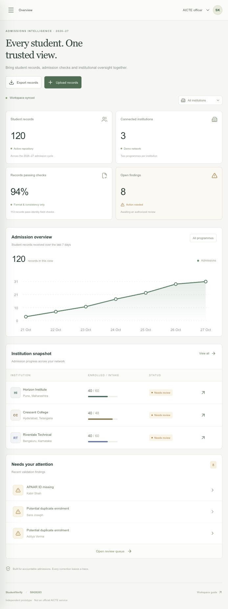
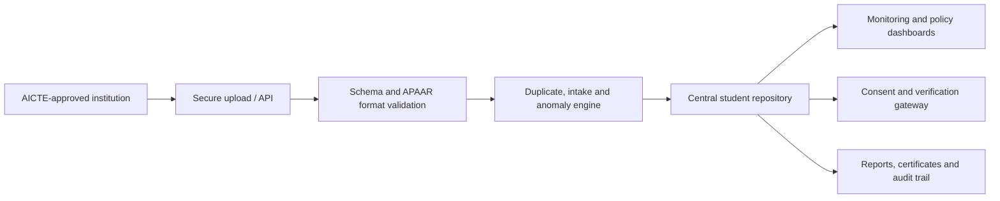

# AICTE StudentVerify

An APAAR-linked student data management and verification prototype for AICTE-approved institutions. The platform brings institution submissions, automated validation, admission monitoring, consent-based verification, reporting, and policy simulation into one operational workspace.

> **Prototype status:** All records and APAAR responses are synthetic. This repository is not connected to production AICTE, APAAR, DigiLocker, or Academic Bank of Credits services.



## Why this system exists

Student information currently arrives through different institutional submission processes. StudentVerify demonstrates a unified flow in which institutions submit student-level records against an APAAR identifier and AICTE can monitor quality, intake compliance, duplicate enrolment signals, and verification requests in near real time.

## Core capabilities

- Institution-level CSV submission with preview and structural validation.
- Missing or malformed APAAR detection and potential duplicate matching.
- Approved-intake, supernumerary, NRI, OCI, and foreign-national monitoring.
- Cross-institution academic timeline and explainable conflict investigation.
- AICTE and institution dashboard perspectives with searchable records.
- Consent-controlled stakeholder verification demonstration.
- Policy Digital Twin for simulating intake changes before implementation.
- Reports, certificate display, audit activity, and integration API examples.

## Signature innovation

The **Policy Digital Twin** turns the platform from a reporting portal into a planning tool. Authorized users can model institution-level intake changes, calculate affected seats, identify projected breaches, and save an auditable scenario without modifying operational records.

The investigation workspace complements it with three synchronized views:

1. A student academic timeline.
2. A cross-institution relationship graph.
3. A side-by-side conflict comparison with source evidence and suggested next steps.

## System design



The current prototype uses React and TypeScript with Vinext, Cloudflare Workers, and D1. See [System Architecture](docs/ARCHITECTURE.md) for component boundaries, request flows, data handling, and production recommendations.

## Repository map

```text
app/
  api/                 Server routes for workspace, integration and policy simulation
  globals.css          Portal design system and responsive layouts
  page.tsx             Dashboard and operational workflows
db/                    Drizzle schema and database access
drizzle/               Append-only D1 migrations
docs/                  Architecture and development documentation
lib/model.ts           Shared domain types, synthetic data and validation rules
worker/                 Cloudflare worker entry point
scripts/                Portable build and local runtime tooling
```

## Local development

Requirements: Node.js 22.13 or newer and pnpm.

```bash
pnpm install --frozen-lockfile
pnpm exec tsc --noEmit
pnpm run build
pnpm run dev
```

For local D1 setup, migration rules, and handoff notes, see [Development Guide](docs/DEVELOPMENT.md).

## Security boundaries

- Role switching is a prototype perspective selector, not production authorization.
- APAAR values are format-checked locally; authenticity is not asserted.
- Duplicate enrolments are review signals and may represent valid transfers or concurrent study.
- Production deployment requires institution-scoped authentication, server-enforced consent, least-privilege verification responses, encrypted secrets, and an immutable audit design.

## License and use

This is a concept implementation for SIH problem statement 26263. Validate all regulatory, privacy, security, accessibility, and integration requirements with AICTE and authorized ecosystem partners before production use.
