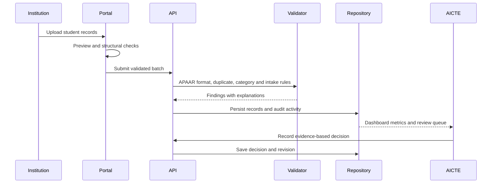

# System Architecture

## Design goals

StudentVerify is organized around four constraints: trustworthy institutional submissions, explainable validation, privacy-aware verification, and a clean path to integration with existing AICTE systems. The repository currently implements a synthetic prototype; the boundaries below make the production gaps explicit.

## Components

| Component | Current implementation | Responsibility |
| --- | --- | --- |
| Portal UI | React, TypeScript, Vinext | Dashboards, uploads, records, review, verification, reporting, and policy scenarios |
| Workspace API | `app/api/workspace/route.ts` | Persist the private prototype workspace with revision-based concurrency protection |
| Integration API | `app/api/integration/route.ts` | Demonstrate institution-scoped batch validation contracts |
| Verification API | `app/api/verification/route.ts` | Enforce expiring demo consent and return a purpose-bound, limited synthetic response |
| Policy Twin API | `app/api/policy-twin/route.ts` | Calculate, save, list, and remove intake-planning scenarios |
| Domain model | `lib/model.ts` | Shared types, synthetic fixtures, capacities, and validation rules |
| Data layer | Drizzle ORM and Cloudflare D1 | Store workspaces and policy scenarios |
| Worker runtime | Cloudflare Worker | Serve the application and bind runtime services |

## Primary request flow

## Data and trust boundaries

The browser may provide usability checks, but the server must remain authoritative. Every production write should be associated with an authenticated operator, institution scope, purpose, timestamp, and request identifier. Verification consumers should receive only explicitly permitted fields rather than the full student workspace.

The current private preview uses a platform-provided user header and falls back to a local demonstration workspace when the header is absent. That fallback must be removed before shared or public deployment.

The high-volume synthetic workspace is gzip-serialized before D1 persistence and transparently expanded by the API. This keeps the 10,000-record demo below local D1 value limits; production should use normalized student and enrolment tables rather than a compressed workspace document.

The verification route enforces consent on the server and records the stakeholder type and stated purpose in workspace activity. This strengthens the demonstration flow but does not replace authenticated verifier identity or real student authorization.

## Credentials and tokens

No APAAR or AICTE credentials are included in this repository. Local secrets and environment files are excluded by `.gitignore`. In production:

- Store service credentials in a managed secret store, never in source control or browser bundles.
- Exchange short-lived access tokens through a server-side identity provider.
- Validate token issuer, audience, expiry, signature, and institution claims on every protected request.
- Use separate credentials and scopes for institution submission, AICTE administration, and stakeholder verification.
- Rotate integration secrets and record security-relevant activity without logging tokens or sensitive student fields.

## Production evolution

1. Add a real identity provider with AICTE, institution, verifier, and auditor roles.
2. Normalize students, enrolments, institutions, programmes, consent, findings, evidence, and audit events.
3. Replace demonstration APAAR checks with an authorized adapter and retain a labelled sandbox implementation.
4. Enforce consent and field-level disclosure in a dedicated verification gateway.
5. Add signed, verifiable credentials and certificate QR verification.
6. Introduce idempotency keys, rate limits, encrypted storage, retention controls, and immutable audit export.
7. Add automated API, authorization, accessibility, and validation-rule tests.
